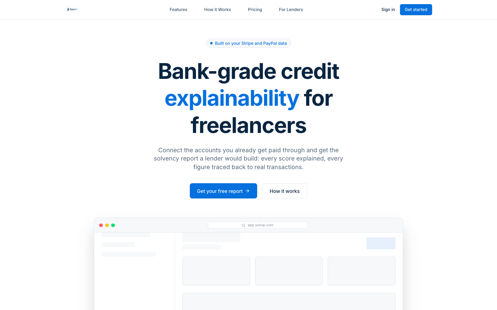
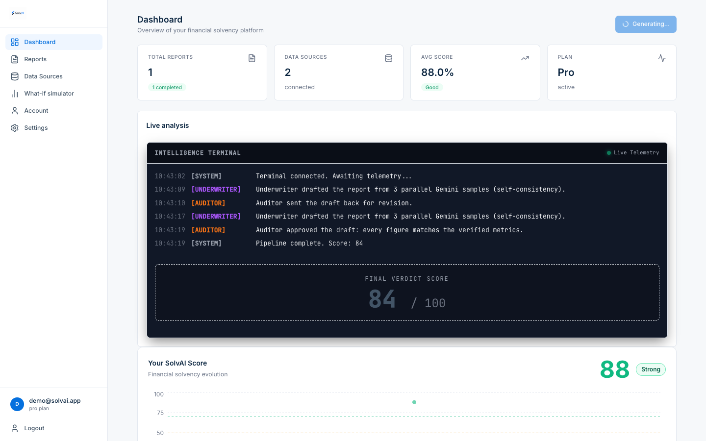
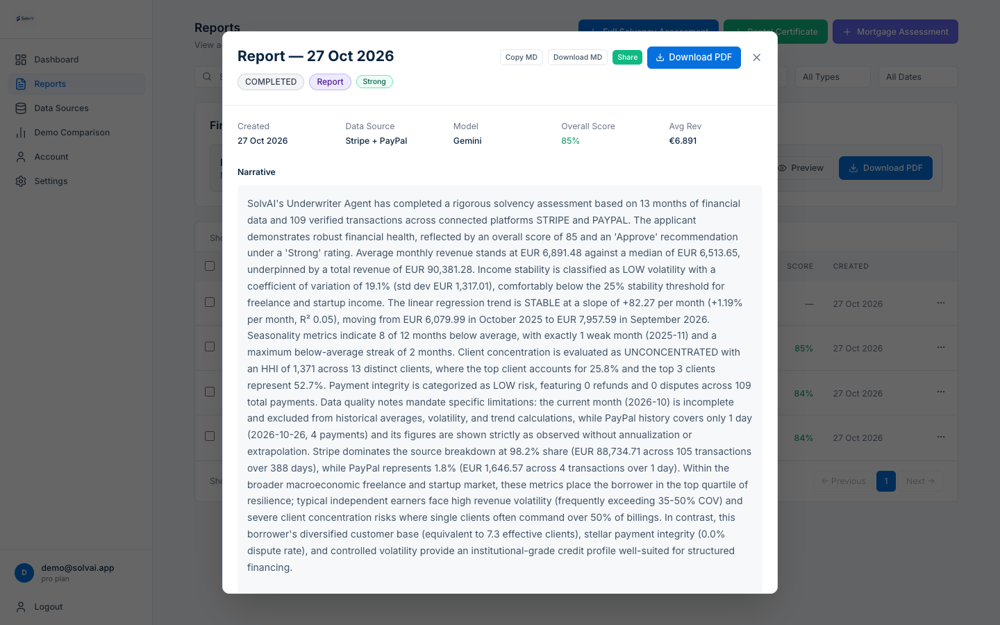
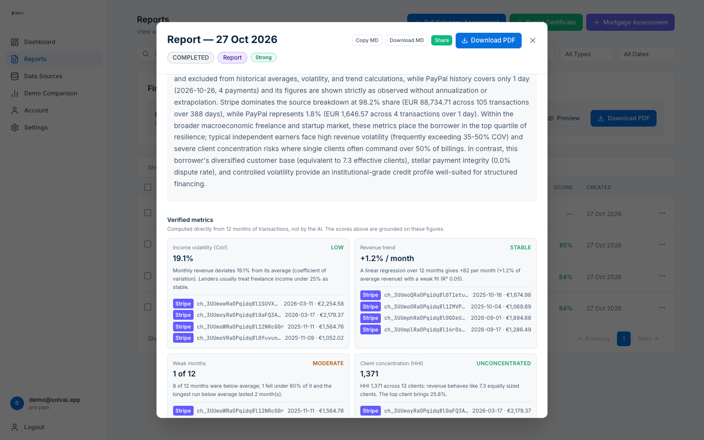
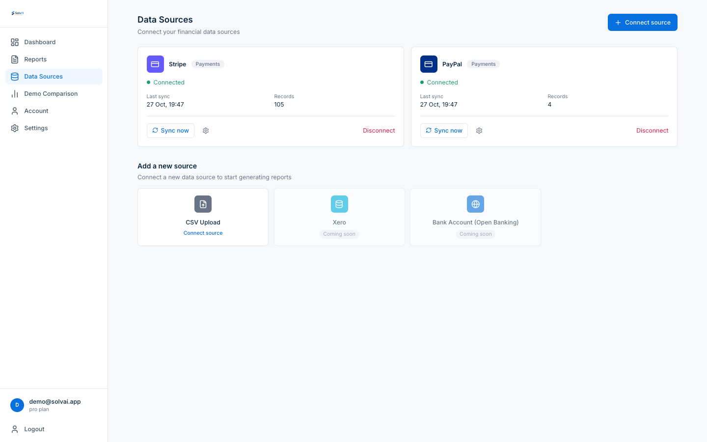
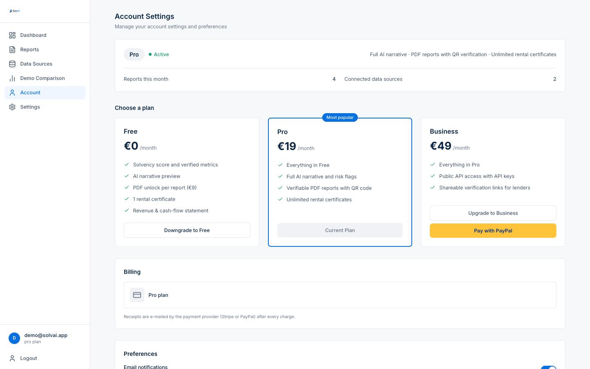
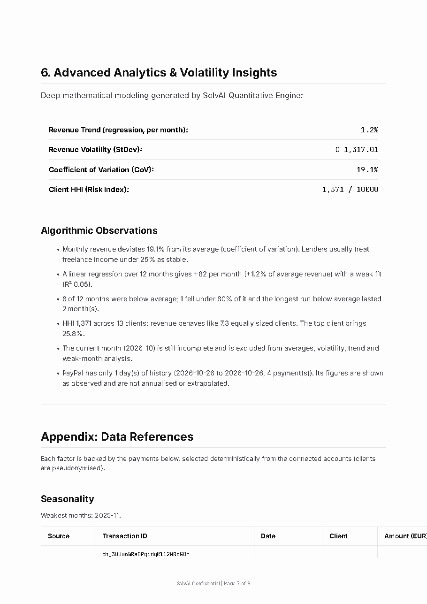
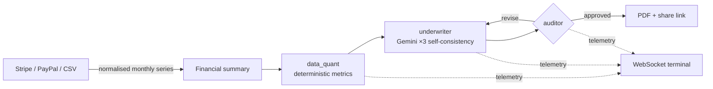

<p align="center">
  
</p>

<h1 align="center">SolvAI</h1>

<p align="center">
  <strong>Bank-grade credit explainability, in the hands of the freelancers who need it most.</strong>
</p>

<p align="center">
  <a href="docs/architecture.md">Architecture</a> ·
  <a href="docs/deploy-vm.md">Deploy (single VM)</a> ·
  <a href="docs/deployment.md">Deploy (Cloud Run)</a> ·
  <a href="docs/demo.md">Demo data</a>
</p>

<p align="center">
  
  
  
  
</p>

---

Banks score borrowers with explainable credit models that the borrower never gets to see. Freelancers and microbusinesses get a "no" with no reason attached. Their income is irregular, comes from a handful of clients and lives in payment platforms rather than in a payslip.

**SolvAI gives them the report a lender would build, before they apply.** They connect their Stripe or PayPal account (or upload a bank statement), and a multi-agent AI pipeline produces a solvency report. Every score, risk flag and recommendation in it is traced back to the underlying transactions. The report can be downloaded as a verifiable PDF or shared with a lender through an expiring link.

## Features

- **Real data, no guesses.** Connects Stripe (secret key), PayPal (REST credentials, Transaction Search), CSV bank statements, Xero and open banking (Belvo). If there is no data, the report fails with a clear reason. It never fabricates figures.
- **Explainable scoring.** Each report covers income stability, growth trend, seasonality, client concentration and reputation signals. The AI scores are grounded on deterministic metrics shown alongside them, each with its value, threshold and plain-language explanation. For each factor it gives a score, a plain-language explanation, what it means to a lender, and references to the transactions behind it.
- **Multi-agent pipeline.** A [LangGraph](https://github.com/langchain-ai/langgraph) graph runs three steps. A deterministic quant step computes the verified metrics: income volatility (coefficient of variation), revenue trend (least-squares regression with R²), weak months and client concentration (Herfindahl-Hirschman Index). A Gemini underwriter runs as three parallel self-consistency samples. A temperature-0 auditor sends weak drafts back for revision.
- **Live reasoning view.** Pipeline progress is streamed over Redis pub/sub and WebSockets to an in-app "Intelligence Terminal".
- **Lender-ready output.** A multi-page PDF (WeasyPrint) includes revenue trend, concentration and radar charts, plus a QR code that opens the copy SolvAI holds, so a lender can check the PDF against the original.
- **More report types.** Rental certificates for tenants, mortgage assessments and a revenue & cash-flow statement built only from connected data (outflows come from uploaded bank statements).
- **Sharing and verification.** Expiring public share links that a lender can open, or reach by scanning the QR code in the PDF.
- **What-if simulator.** Starting from the connected data, sliders for revenue, income smoothness and top-client share recompute the verified metrics (volatility, trend, weak months, HHI, mortgage capacity) with the same rules as a report. Pure arithmetic: it never invents a score.
- **SaaS foundations.** Freemium plans paid with Stripe or **PayPal Subscriptions**, per-report PDF unlocks, signed webhooks, API keys with a public `/v1` API, alerts, six languages and dark mode.

## Screenshots

The demo account below is the same one judges use: 12 months of Stripe test data plus PayPal sandbox payments.

| | |
|---|---|
|  **Landing:** the solvency report a lender would build, for freelancers |  **Live analysis:** the agent pipeline streamed over WebSockets, including an auditor revision round |
|  **Report:** a narrative that quotes the verified metrics |  **Verified metrics:** each factor with its threshold, explanation and real transaction IDs |
|  **Data sources:** Stripe and PayPal connected, CSV bank statements |  **Billing:** Pro and Business paid with PayPal Subscriptions |
|  **PDF:** deterministic analytics and an appendix of cited payments | |

## Tech stack

| Layer | Technology |
|---|---|
| Frontend | React 18, Vite 5, React Router, Tailwind CSS 4, Recharts, i18next |
| API | Python 3.11, FastAPI, Pydantic v2, SQLAlchemy 2.0 (async), Alembic |
| Async work | Celery, Redis (broker and pub/sub), WebSockets |
| AI | Google Gemini 2.5 Flash and 3.5 Flash-Lite (configurable per agent; runs on the free tier), LangGraph |
| Documents | WeasyPrint, Jinja2, matplotlib, QR codes |
| Payments and data | Stripe, PayPal REST APIs, Xero, Belvo |
| Infrastructure | Google Cloud Run, Cloud SQL (PostgreSQL 16), Memorystore, Secret Manager, Cloud Storage, Cloud Build, Docker |
| Quality | pytest, ruff, ESLint, GitHub Actions |

## How it works



The full request lifecycle, data model and security model are described in [docs/architecture.md](docs/architecture.md).

## Getting started

**Prerequisites:** Docker, Node.js 20+, Python 3.11+.

```bash
git clone https://github.com/Gonzaloogm/SolvAI.git
cd SolvAI
cp .env.example .env          # set GEMINI_API_KEY, JWT_SECRET and ENCRYPTION_KEY
```

**Option A: everything in Docker** (Postgres + pgvector, Redis, API, worker, Flower):

```bash
docker compose up -d
docker compose exec api alembic upgrade head
```

**Option B: API locally**, with Postgres and Redis from Docker:

```bash
docker compose up -d db redis
cd backend
python -m venv .venv && source .venv/bin/activate
pip install -r requirements-dev.txt
cp ../.env .env
alembic upgrade head
uvicorn app.main:app --reload                       # http://localhost:8000/docs
celery -A app.celery_app worker --loglevel=info     # in a second terminal
```

> WeasyPrint needs Pango. On macOS: `brew install pango` (and `export DYLD_FALLBACK_LIBRARY_PATH=/opt/homebrew/lib` on Apple Silicon).

**Frontend:**

```bash
cd frontend
npm install
echo "VITE_API_BASE_URL=http://localhost:8000" > .env.local
npm run dev                                         # http://localhost:5173
```

To try it with real test data, see [docs/demo.md](docs/demo.md).

## Tests and quality

```bash
cd backend && pytest        # unit and API tests; no external services required
cd backend && ruff check .
cd frontend && npm run lint && npm run build
```

CI runs the same checks on every push. It also applies every Alembic migration to a clean pgvector database and builds both Docker images.

## Project structure

```
.
├── backend/            FastAPI app, Celery tasks, Alembic migrations, tests
│   ├── app/            api · core · models · schemas · services · tasks · templates
│   ├── alembic/
│   ├── scripts/        seeding test data, end-to-end smoke test
│   └── tests/
├── frontend/           React SPA (Vite), served by nginx in production
├── docs/               architecture, deployment, demo data
├── deploy/             single-VM stack: Docker Compose, Caddy (HTTPS), deploy and backup scripts
├── scripts/deploy.sh   manual Cloud Run deploy
├── cloudbuild.yaml     CI/CD pipeline to Cloud Run
└── docker-compose.yml  local stack
```

## Roadmap

- Historical comparison between a user's reports
- Guided onboarding for first-time users
- Expense-side data (bank outflows) for a full cash-flow view
- Migration to the new `google-genai` SDK

## License

[MIT](LICENSE) © 2026 Gonzaloogm
