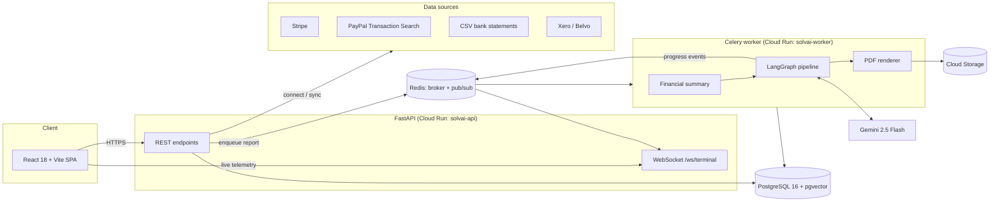

# Architecture

SolvAI turns a freelancer's payment history into an explainable solvency report. Every figure in the report is traceable to real transactions; if a source has no data, the report fails with a clear message instead of inventing numbers.



## Request lifecycle

1. **Connect a source.** The user pastes a Stripe key or PayPal REST credentials, uploads a CSV, or completes an OAuth flow. Credentials are encrypted with Fernet (`ENCRYPTION_KEY`) before they are stored. A normalised monthly snapshot (`monthly_revenue_series`, client concentration, record count) is saved in `financial_data_sources.connection_details`.
2. **Request a report.** `POST /solvency-reports` creates a `PENDING` row and enqueues `generate_solvency_report_task`.
3. **Build the financial summary.** `_build_financial_summary` merges the monthly series from every connected source. If no source has revenue data, the report is marked `FAILED` with an explanation and no AI call is made.
4. **Run the LangGraph pipeline** (`app/services/agent_orchestrator.py`):
   - `data_quant`: deterministic metrics such as Benford's-law deviation and a modified Z-score.
   - `underwriter`: three parallel Gemini calls at temperature 0.4. These self-consistency samples are parsed and validated as JSON, then merged.
   - `auditor`: a temperature-0 review of the draft against the source data. It can send the draft back to the underwriter, up to 3 iterations, or flag it for human review.
   Each step publishes progress to Redis (`solvai:telemetry:{report_id}`), which the WebSocket streams to the "Intelligence Terminal" in the UI.
5. **Render and store.** WeasyPrint and Jinja2 templates (`app/templates/`) render the PDF with matplotlib charts and a verification QR code. The file is uploaded to Cloud Storage and the report becomes `COMPLETED`.

## Data source adapters

Every adapter returns the same metrics shape (`avg_monthly`, `monthly_revenue`, `client_concentration`, `transactions_sample`, `span_months`). The pipeline therefore does not care where the data came from.

| Source | Module | Auth | Notes |
|---|---|---|---|
| Stripe | `services/stripe_service.py` | User's secret key | Successful charges, net of refunds |
| PayPal | `services/paypal_service.py` | User's REST app (client credentials) | Transaction Search in ≤31-day windows with pagination. Revenue counts `T00xx` payments net of `T11xx` refunds. Deposits, transfers and fees are excluded |
| CSV | `services/csv_service.py` | Upload, then preview and confirm | Bank statement exports |
| Xero | `services/xero_service.py` | OAuth 2.0 | Paid invoices. Webhooks are HMAC-verified |
| Belvo | `services/belvo_service.py` | Open-banking link | Sandbox |

## Backend layout

```
backend/
├── app/
│   ├── api/          # FastAPI routers, one per domain (auth, data_sources, solvency_reports, billing, verify, …)
│   ├── core/         # settings, async DB session, security (JWT, bcrypt, Fernet)
│   ├── models/       # SQLAlchemy 2.0 models
│   ├── schemas/      # Pydantic request/response models
│   ├── services/     # integrations, AI orchestration, PDF, storage, e-mail
│   ├── tasks/        # Celery tasks (report generation, recalculation)
│   ├── templates/    # Jinja2 templates for the PDF reports
│   └── utils/
├── alembic/          # database migrations
├── scripts/          # operational scripts (seeding test data, end-to-end smoke test)
└── tests/            # pytest suite (no external services required)
```

## Frontend layout

```
frontend/src/
├── api/client.js     # Axios client, one object per backend domain
├── components/       # shared UI (report modal, gauge, terminal, sidebar, …)
├── context/          # theme, toasts, report-generation polling
├── i18n/             # en, es, de, fr, it, pt
└── pages/            # routed pages (dashboard, reports, data sources, verify portal, …)
```

## Security model

- JWT bearer authentication on every user endpoint. Passwords are hashed with bcrypt.
- Provider credentials are encrypted at rest with Fernet and never logged.
- `/admin/*` endpoints require the `X-Admin-Key` header.
- Stripe and Xero webhooks verify their signatures before acting.
- In production, secrets come from GCP Secret Manager.
- PDF downloads are gated by plan or per-report unlock, and ownership is checked server-side.
