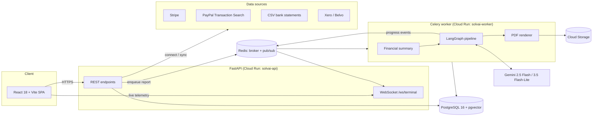

# Architecture

SolvAI turns a freelancer's payment history into an explainable solvency report. Every figure in the report is traceable to real transactions; if a source has no data, the report fails with a clear message instead of inventing numbers.



## Request lifecycle

1. **Connect a source.** The user pastes a Stripe key or PayPal REST credentials, uploads a CSV, or completes an OAuth flow. Credentials are encrypted with Fernet (`ENCRYPTION_KEY`) before they are stored. A normalised monthly snapshot (`monthly_revenue_series`, client concentration, record count) is saved in `financial_data_sources.connection_details`.
2. **Request a report.** `POST /solvency-reports` creates a `PENDING` row and enqueues `generate_solvency_report_task`.
3. **Build the financial summary.** `_build_financial_summary` merges the monthly series from every connected source. If no source has revenue data, the report is marked `FAILED` with an explanation and no AI call is made.
4. **Run the LangGraph pipeline** (`app/services/agent_orchestrator.py`):
   - `data_quant`: deterministic metrics from `app/services/quant_service.py`. These are the ground truth the AI must quote:
     | Metric | Method | Interpretation |
     |---|---|---|
     | Income volatility | Coefficient of variation (sample std. dev. / mean) | < 25% stable, ≥ 50% high |
     | Revenue trend | Least-squares slope as % of mean revenue, with R² | Flat within ±1%/month or R² < 0.3 |
     | Weak months | Months below the mean and below 80% of it, plus the longest run below the mean | |
     | Client concentration | Herfindahl-Hirschman Index over per-client revenue from every source | < 1,500 unconcentrated, > 2,500 high (DOJ/FTC thresholds) |
     | Payment integrity (shown as the "reputation" factor) | Refund rate (refunded / gross) and dispute or chargeback rate across Stripe and PayPal, plus history length | Disputes ≥ 1% or refunds ≥ 10% high, any dispute or refunds ≥ 3% moderate |
   - `underwriter`: three parallel Gemini calls at temperature 0.4 (`GEMINI_UNDERWRITER_MODEL`, default `gemini-2.5-flash`). These self-consistency samples are parsed and validated as JSON, then merged.
   - `auditor`: a temperature-0 review of the draft against the source data (`GEMINI_LIGHT_MODEL`, default `gemini-3.5-flash-lite`, also used by the score simulator). It can send the draft back to the underwriter, up to 3 iterations, or flag it for human review.
   Each step publishes progress to Redis (`solvai:telemetry:{report_id}`), which the WebSocket streams to the "Intelligence Terminal" in the UI.
5. **Render and store.** WeasyPrint and Jinja2 templates (`app/templates/`) render the PDF with matplotlib charts and a verification QR code. The file is uploaded to Cloud Storage and the report becomes `COMPLETED`.

Every factor is also backed by **evidence**: real transaction IDs (Stripe charges, PayPal transactions) selected by fixed rules, such as the largest payments in the highest and lowest months or the top client's largest payments. The report appendix lists these, never IDs written by the model. Clients are pseudonymised (`Client 1` = highest revenue). The summary also carries a per-source breakdown (share, payments, days covered). A source with a short history is described as observed and never annualised, and the current, incomplete month is left out of every statistic.

A report makes about 4 Gemini calls when the first draft is approved and up to 12 with three audit rounds. To run entirely on the Gemini free tier, set both models to `gemini-3.5-flash-lite`; Lite models usually get the most generous free quota (check your project's limits in Google AI Studio). If the AI fails, the report is marked `FAILED` with a reason: there is no mocked or placeholder score.

## Data source adapters

Every adapter returns the same metrics shape (`avg_monthly`, `monthly_revenue`, `client_concentration`, `transactions_sample`, `span_months`). The pipeline therefore does not care where the data came from.

| Source | Module | Auth | Notes |
|---|---|---|---|
| Stripe | `services/stripe_service.py` | User's secret key | Successful charges, net of refunds |
| PayPal | `services/paypal_service.py` | User's REST app (client credentials) | Transaction Search in ≤31-day windows with pagination. Revenue counts `T00xx` payments net of `T11xx` refunds. Deposits, transfers and fees are excluded |
| CSV | `services/csv_service.py` | Upload, then preview and confirm | Bank statement exports |
| Xero | `services/xero_service.py` | OAuth 2.0 | Paid invoices. Webhooks are HMAC-verified |
| Belvo | `services/belvo_service.py` | Open-banking link | Sandbox |

## Backend layout

```
backend/
├── app/
│   ├── api/          # FastAPI routers, one per domain (auth, data_sources, solvency_reports, billing, public_reports, …)
│   ├── core/         # settings, async DB session, security (JWT, bcrypt, Fernet)
│   ├── models/       # SQLAlchemy 2.0 models
│   ├── schemas/      # Pydantic request/response models
│   ├── services/     # integrations, AI orchestration, PDF, storage, e-mail
│   ├── tasks/        # Celery tasks (report generation, recalculation)
│   ├── templates/    # Jinja2 templates for the PDF reports
│   └── utils/
├── alembic/          # database migrations
├── scripts/          # operational scripts (seeding test data, end-to-end smoke test)
└── tests/            # pytest suite (no external services required)
```

## Frontend layout

```
frontend/src/
├── api/client.js     # Axios client, one object per backend domain
├── components/       # shared UI (report modal, gauge, terminal, sidebar, …)
├── context/          # theme, toasts, report-generation polling
├── i18n/             # en, es, de, fr, it, pt
└── pages/            # routed pages (dashboard, reports, data sources, public report, …)
```

## Security model

- JWT bearer authentication on every user endpoint. Passwords are hashed with bcrypt.
- Provider credentials are encrypted at rest with Fernet and never logged.
- `/admin/*` endpoints require the `X-Admin-Key` header.
- Stripe and Xero webhooks verify their signatures before acting.
- In production, secrets come from GCP Secret Manager.
- PDF downloads are gated by plan or per-report unlock, and ownership is checked server-side.
